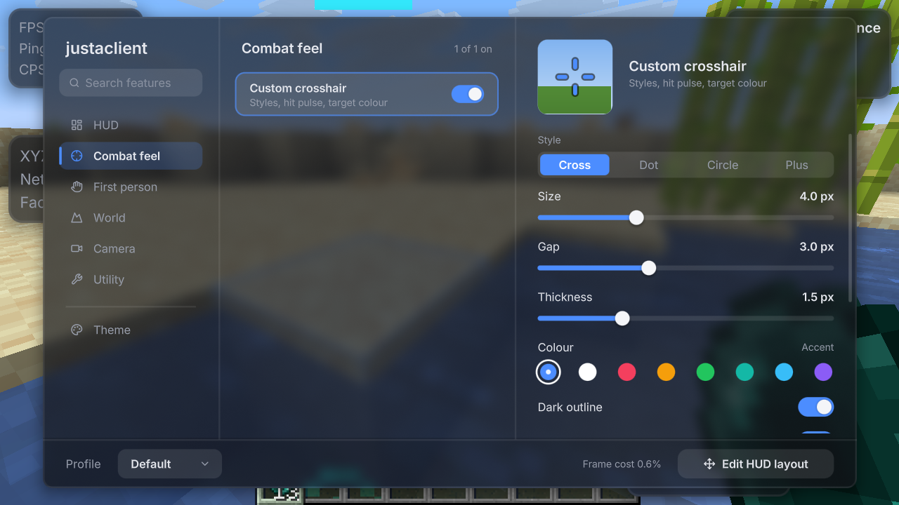
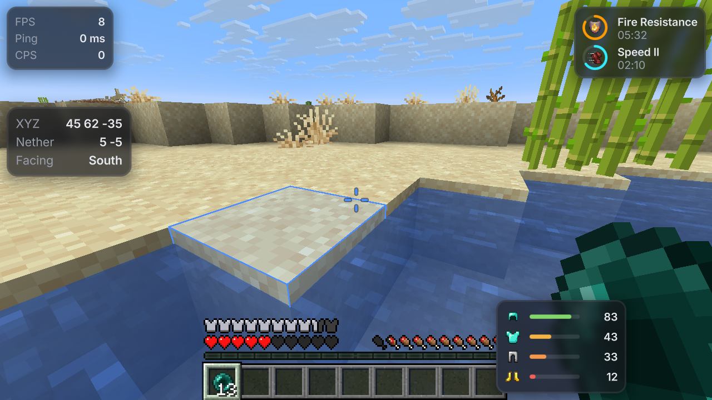
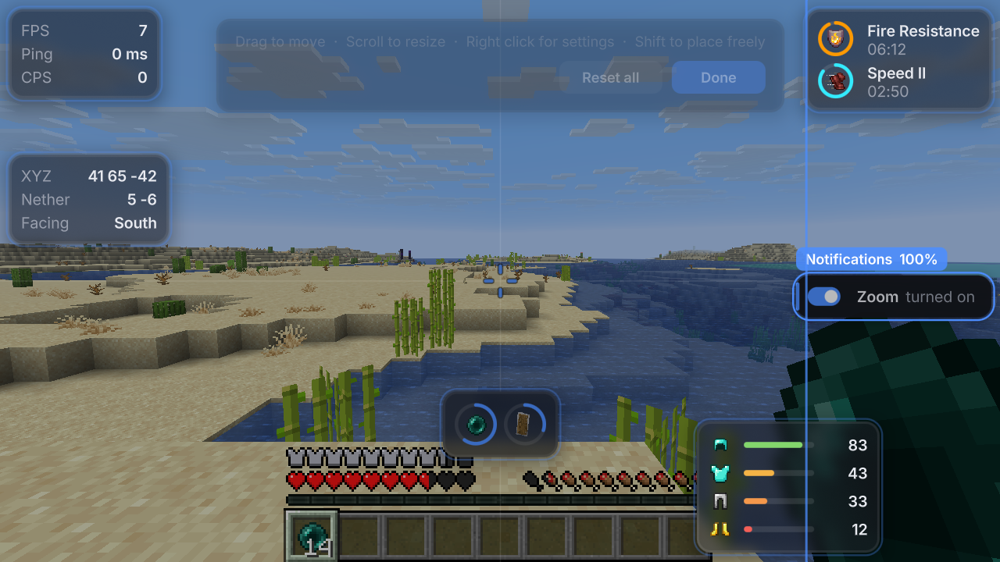
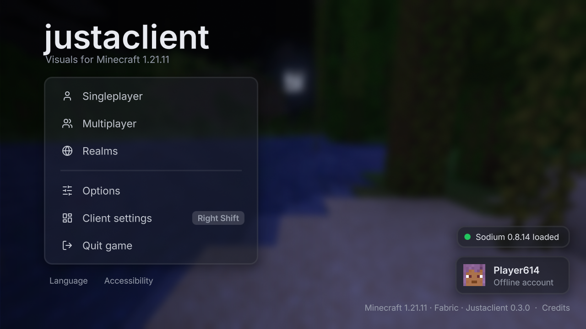
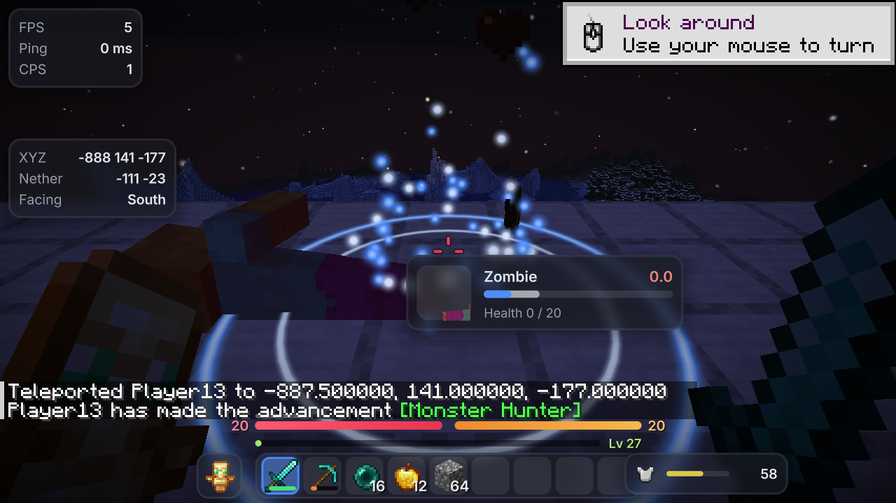
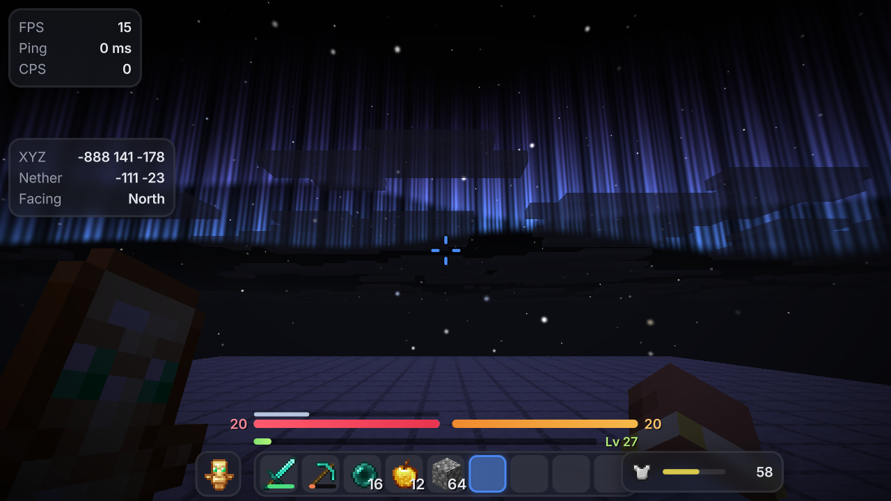
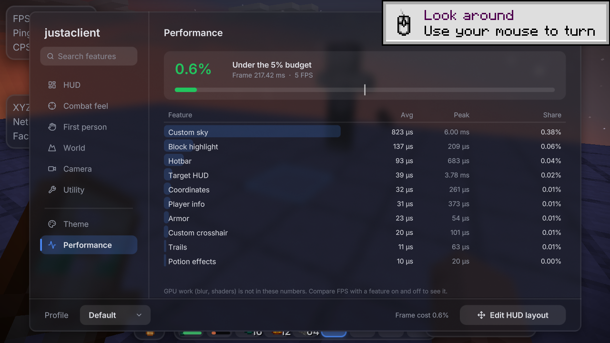

# Justaclient

A visuals-only Fabric client for Minecraft Java **1.21.11**. Smooth animated UI, frosted-glass panels, crisp fonts and a
look you can fully re-theme. No cheats: nothing that reveals hidden information or automates play.

Requires **Fabric API** and **Sodium**.

## Quick start (Windows)

1. Install **Java 21** (Temurin): https://adoptium.net/temurin/releases/?version=21
2. Double-click **`start.bat`** and pick:
   - **1 Play**: launches Minecraft with Justaclient, Fabric API and Sodium already loaded. The first launch downloads
     Minecraft and takes a few minutes; later launches are quick. It runs offline as a dev player, so use singleplayer.
   - **2 Build**: makes the mod jar in `build\libs\` for your normal launcher.
3. In game (or on the title screen), press **Right Shift** to open the Justaclient menu. Hold **C** to zoom.

macOS / Linux: `./start.sh` to play, `./start.sh build` to build.

## Install into your own launcher

1. Build with `start.bat` option 2 (or `gradlew build`).
2. Copy `build/libs/justaclient-<version>.jar` (not the `-sources` jar) into your `.minecraft/mods` folder.
3. Also put in `mods`: [Fabric API](https://modrinth.com/mod/fabric-api) and [Sodium](https://modrinth.com/mod/sodium),
   both for 1.21.11, and run the Fabric 1.21.11 profile.

## Using it

| Where | What to do |
| --- | --- |
| **Right Shift** | Opens the menu: categories on the left, features in the middle, settings on the right. |
| Typing in the menu | Searches every feature and setting. Esc clears the search, Esc again closes. |
| Feature cards | Click to see settings, click the switch (or right click the card) to turn it on or off. |
| **Toggle key** row | Click it and press any key to toggle that feature in game. Esc or Backspace unbinds. |
| **Profile** (bottom left) | Switch profiles, copy the current one, copy it to the clipboard to share, paste one a friend sent, delete it, or open the profiles folder. |
| **Edit HUD layout** | Drag widgets; they snap to edges, the centre and each other (hold Shift to place freely). Scroll to resize, right click for settings. |
| **Theme** | Accent, panel opacity, corners, blur, outline, font and motion. Everything follows these. |
| **Performance** (menu, or click the frame cost in the footer) | What each feature costs per frame, against the 5% budget. |
| **C** (hold) | Zoom. Scroll while zooming to go further. The key is in Camera > Zoom. |

## What is in this build

### M2: release

- **Title screen**: wordmark, a glass menu with keyboard navigation, your account and skin, and a blurred panorama,
  plain panorama or animated gradient behind it (Utility > Title screen). Turn it off for vanilla's.
- **Hotbar**: a glass hotbar with a sliding selection, offhand slot and attack indicator, plus smooth health (with a
  damage ghost, absorption and low-health pulse), hunger, armor, air and XP bars. Spectator mode keeps vanilla's.
- **Item overlay**: smooth or accent durability bars, cooldown rings, and sharp stack counts in every inventory.
- **Target HUD**: face, name and health of whatever you hit, with a damage ghost on the bar.
- **Combat feel** (all cosmetic, driven only by what vanilla already shows): hit particles, hit sounds, kill effects
  (ring burst, rising soul or shatter), totem pop effects with a pop counter, and a ring or orbit marker under your
  target.
- **Sky**: twinkling extra stars, an aurora over the north and shooting stars at night, plus an optional day sky tint.
  Overworld only, and drawn behind everything like vanilla's sky.
- **Fog**: push air fog further out and recolour it per dimension. Water, lava, blindness and darkness are untouched.
- **Trails and jump circles**: a ribbon or dotted trail behind you (and optionally other players), and rings when you
  jump or land.
- **Profiles**: copy a profile to the clipboard and paste one from a friend; it arrives as a new profile.
- **Performance page**: CPU time per feature (average, peak and share of the frame) against a 5% budget. GPU time is
  not included; compare FPS with a feature on and off for that.

The world effects (sky, fog, trails, jump circles, hit sounds) start off; turn them on under World and Combat feel.

### M1: first playable

- **Click GUI** with categories, live search, animated switches, sliders, choices, colour pickers and key binders.
  Every feature has a toggle key.
- **Profiles**: each one is a JSON file in `config/justaclient/profiles/` (features, settings, keys and HUD layout), so
  they can be shared by copying the file. The theme is separate and stays in `config/justaclient.json`.
- **HUD editor** with snapping, guides, per-widget scale, and a tray to switch hidden widgets back on.
- **HUD widgets**: player info (FPS, ping, CPS, speed), coordinates (nether conversion, facing, biome, clock), armor
  durability (bar, percent or number), potion effects with timer rings, item cooldown dials, and toggle notifications.
- **Custom crosshair**: cross, dot, circle or plus; size, gap, thickness, colour, outline, hit pulse, target colour and
  dynamic spread. Follows vanilla's attack indicator setting.
- **Zoom**: smooth, scroll to adjust, slower mouse while zoomed, optional cinematic camera.
- **Block highlight**: an outline and fill that glide between blocks and show mining progress. Depth tested, never
  see-through.
- **Fire overlay**: lower it or hide it.
- **Copy coordinates** to the clipboard with one key.
- **Icons**: a Lucide icon set drawn with the same SDF text renderer, tinted by the accent.
- **Frame cost** in the menu footer: CPU time spent in Justaclient's HUD and world hooks as a share of the frame.

### M0: foundation

- **Render kit**: anti-aliased rounded rectangles, outlines, gradients, soft shadows, glow and ring arcs, drawn with
  signed distance field shaders and batched by Minecraft's GUI renderer.
- **Frosted glass**: a dual Kawase blur of the world (or title panorama) behind panels, done at half resolution and
  only on frames that show a glass panel.
- **Sharp text**: Inter rendered from multi-channel signed distance field atlases, so it stays crisp at every GUI scale.
- **Animation library**: easing curves, timed animations and springs, all scaled by the Motion setting.
- **Style tokens**: accent (solid, gradient or rainbow), surface colour and opacity, blur, corner radius, outline,
  font and motion. Default look is dark glass: blue accent `#4C8DFF`, 70% surface, 6 px corners.

## Project layout

| Path | What it holds |
| --- | --- |
| `src/main/java/dev/justaclient/render/` | Shape kit (`Draw`), blur (`BlurEngine`), pipelines, world effects (`WorldFx`) |
| `src/main/java/dev/justaclient/render/text/` | MSDF font loader and text renderer (`JacText`) |
| `src/main/java/dev/justaclient/anim/` | `Easing`, `Animation`, `Spring`, `Colors` |
| `src/main/java/dev/justaclient/config/` | Style tokens and JSON config |
| `src/main/java/dev/justaclient/feature/` | Feature and setting framework, the feature list, non-HUD features (`impl/`) |
| `src/main/java/dev/justaclient/hud/` | HUD renderer, widget base classes and the widgets (`widgets/`) |
| `src/main/java/dev/justaclient/profile/` | Profile files |
| `src/main/java/dev/justaclient/ui/` | Click GUI, HUD editor, theme and performance pages, title screen, controls |
| `src/main/java/dev/justaclient/mixin/` | Small hooks: zoom FOV and mouse, CPS, fire overlay, hit pulse, blur capture, combat events, item decorations, sky, fog, title screen |
| `src/main/resources/assets/justaclient/shaders/` | GLSL for shapes, glass, text, blur, world effects and the aurora |
| `tools/fonts/` | Script that regenerates the font and icon atlases (`icons.txt` lists the icons) |

## Development

- `gradlew runClient` launches the dev client; `gradlew build` makes the jar.
- `gradlew genSources` decompiles Minecraft (official Mojang names) for reading.
- Java 21, Fabric Loom 1.16, official Mojang mappings.

## Credits

- [Inter](https://rsms.me/inter/) by Rasmus Andersson, SIL Open Font License 1.1 (`assets/justaclient/msdf/Inter-LICENSE.txt`).
- [Lucide](https://lucide.dev/) icons, ISC License (`assets/justaclient/msdf/Lucide-LICENSE.txt`).
- Dual Kawase blur after Marius Bjørge, "Bandwidth-Efficient Rendering", SIGGRAPH 2015.

## License

MIT, see `LICENSE`.
