# Justaclient

A visuals-only Fabric client for Minecraft Java **1.21.11** and **26.3**. Smooth animated UI, frosted-glass panels, crisp fonts and a
look you can fully re-theme. No cheats: nothing that reveals hidden information or automates play.

Requires **Fabric API** and **Sodium**.

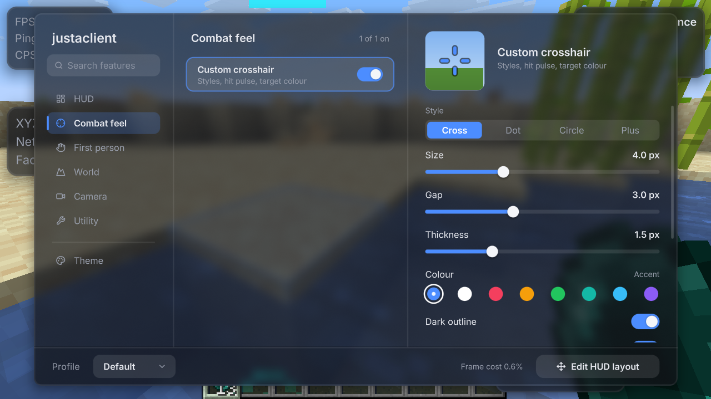

## Quick start (Windows)

1. Install Java (Temurin): **Java 25** runs both versions: https://adoptium.net/temurin/releases/?version=25
   (Java 21 is enough if you only want 1.21.11.)
2. Double-click **`start.bat`**, pick the Minecraft version (**1** = 1.21.11, **2** = 26.3), then:
   - **1 Play**: launches Minecraft with Justaclient, Fabric API and Sodium already loaded. The first launch downloads
     Minecraft and takes a few minutes; later launches are quick. It runs offline as a dev player, so use singleplayer.
   - **2 Build**: makes the mod jar for your normal launcher (`build\libs\` for 1.21.11, `mc26.3\build\libs\` for 26.3).
3. In game (or on the title screen), press **Right Shift** to open the Justaclient menu. Hold **C** to zoom.

macOS / Linux: `./start.sh` plays 1.21.11, `./start.sh 26.3` plays 26.3; add `build` to build instead
(`./start.sh 26.3 build`).

## Install into your own launcher

1. Build with `start.bat` option 2 (or `gradlew build` for 1.21.11, `gradlew -p mc26.3 build` for 26.3).
2. Copy `justaclient-<version>+<minecraft version>.jar` (not the `-sources` jar) into your `.minecraft/mods` folder.
3. Also put in `mods`: [Fabric API](https://modrinth.com/mod/fabric-api) and [Sodium](https://modrinth.com/mod/sodium)
   for the same Minecraft version, and run that version's Fabric profile.

## Using it

| Where | What to do |
| --- | --- |
| **Right Shift** | Opens the menu: categories on the left, features in the middle, settings on the right. |
| Typing in the menu | Searches every feature and setting (or click the search box). The x or a right click clears it, Esc clears it too, Esc again closes. |
| Feature cards | Click to see settings, click the switch (or right click the card) to turn it on or off. |
| **Toggle key** row | Click it and press any key to toggle that feature in game. Esc or Backspace unbinds. |
| **Profile** (bottom left) | Switch profiles, copy the current one, copy it to the clipboard to share, paste one a friend sent, export to a file (choose which parts), import a file with a preview of what changes, delete it, open the profiles folder, or reset everything (a backup is saved first). |
| **Edit HUD layout** | Drag widgets; they snap to edges, the centre and each other with a small gap (hold Shift to place freely). Drag a corner or scroll to resize, press **A** over a widget to change its anchor, right click for settings. **Layout** switches between Default, Combat, Explore, Minimal and your own saved layouts. |
| **Notes** (menu sidebar) | A notepad and a todo list. Pin a todo to show it on the Pinned todos widget. |
| **Feedback** (menu sidebar) | Send a bug report or idea, with your log, crash report, mod list or settings attached. Off until you turn it on and set your server (see `cloudflare/README.md`). |
| **Theme** | Accent, panel opacity, corners, blur, outline, font, motion and the menu layout (Classic or Ring). Everything follows these. |
| **Ring layout** | With Theme > Menu layout on Ring, Right Shift opens the ring: click a panel for its category, a button on the ring for a page. **Customise** (bottom right) changes the ring's look, spin, density, glow, gauges and what is shown, live. **Classic view** switches back. |
| **Command Centre** (menu sidebar) | Tiles for the client's full screens: Mods, Servers, Key binds, Screenshots, HUD editor, Dev Console, World Archive and Labs. |
| **Performance** (menu, or click the frame cost in the footer) | What each feature costs per frame, against the 5% budget. |
| **C** (hold) | Zoom. Scroll while zooming to go further. The key is in Camera > Zoom. |
| **I** | Inspect the held item (First person > Hand). |
| **M** | Open the map. Drag (or arrow keys) to move, scroll to zoom, Space to find yourself, right-click to drop a waypoint, and click one to rename, move, recolour, track, hide or delete it. |
| **Stats** (menu sidebar) | Lifetime play time, kills, deaths, blocks and records. **Sessions** lists past sessions; click one to see what you carried and picked up. |
| **T** (chat) over the Spotify card | Click its previous, play and next buttons. With the chat open you can also grab and throw the physics trinket. |
| **B** | Save a waypoint where you stand. `/jwp list`, `/jwp gps <name>`, `/jwp remove <name>` manage them too. |
| **Middle click** a player | Add or remove a friend. `/jfriend add <name>` and `/jfriend list` work too. |

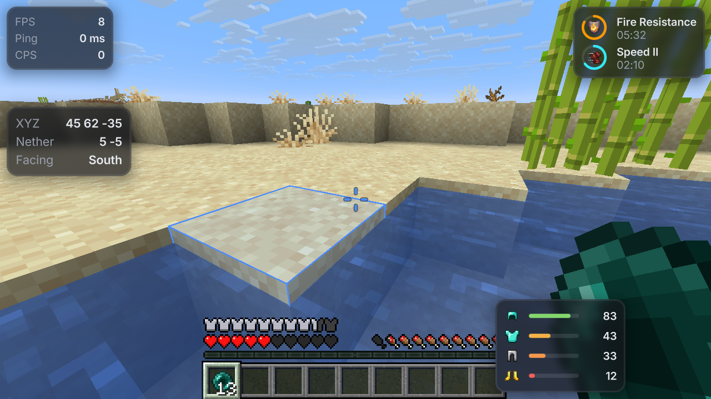

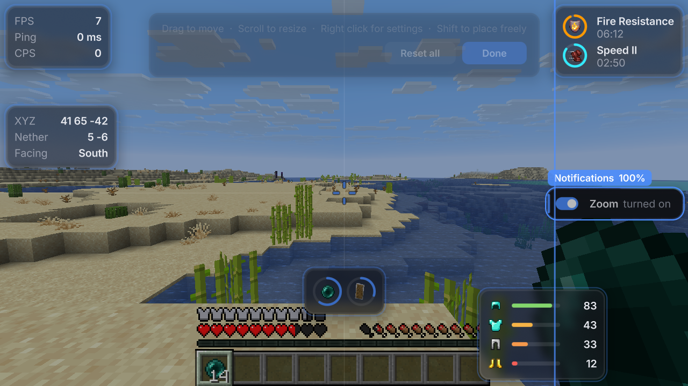

## What is in this build

### v0.12.4: Modrinth icons and a Tiles view

- **Project icons** in the Modrinth browser: every result, the list rows and the details header show the project's
  real icon from Modrinth instead of a coloured letter. Icons load in the background (the letter shows until one
  arrives, then the icon fades in) and are kept in `config/justaclient/cache/modrinth-icons` so the next visit is
  instant. Modrinth's WebP icons are read with the bundled TwelveMonkeys WebP decoder.
- **Tiles view** (the default): just the icon and the name, as many tiles across as fit, with a small mark on installed
  or loaded projects and on ones with an update. The **View** chip (or *Results as* in the browser's settings) switches
  between Tiles and List, and is saved in your profile. Left and right arrow keys move across tiles.

### Fixes (v0.12.3)

- **Mod settings in the Mods panel**: nearly every mod showed "No settings". Mods hand their settings screen over
  through Mod Menu's API, and without Mod Menu installed those classes don't exist, so the lookup failed quietly. The
  client now puts a small stand-in for that API on the class path at launch when Mod Menu isn't installed (with Mod Menu
  installed, Mod Menu's own classes are used). Mods that keep their options inside Sodium's video settings (Sodium Extra
  and other Sodium add-ons) open Sodium's screen on their own page.
- Closing a mod's settings screen goes back to the Mods panel. Screens that close to nothing used to land on the
  vanilla title screen.

### v0.12.2: fits GUI scale 4 and small windows

Everything was checked at GUI scale 2, 3 and 4 on a 1080p window and at the smallest size the game allows (320 by 240
GUI units, e.g. 1280x960 at scale 4), on both 1.21.11 and 26.3.

- **Client screens** (Mods, Servers, Key binds, Screenshots, Modrinth, Storage, Kits and the rest), the title screen
  and the crash helper keep their layout on a small window and are drawn a little smaller instead of overlapping or
  running off the edge. At GUI scale 4 on 1080p they are not shrunk at all.
- **HUD** widgets shrink a little on small GUIs (about 80% at GUI scale 4 on 1080p, never below 60%) so the default
  layout no longer piles up. It is a switch on the HUD editor feature: *Shrink widgets on small screens and big GUI
  scales*. Your own Scale setting for each widget still applies on top.
- **Command Centre** tiles scroll when there are more than fit, instead of running out of the menu.
- **Setting names** too long for one line wrap beside their switch, and slider and key names shorten with "..."
  rather than running under the value.
- **Container panels** (furnace info, brewing guide, anvil and crafting helpers) shrink to fit beside the container
  on a narrow window instead of running off the screen.
- **Title screen**: the account card moves to the bottom right when the tip line needs the space.
- For developers: `-Djustaclient.uiTour=<folder>` opens every client screen at each GUI scale
  (`-Djustaclient.uiTourScales=2,3,4`) and saves a screenshot of each, then quits. Add `--quickPlaySingleplayer <world>`
  for the in-world screens.

### M12: spatial menus and the Modrinth browser (v0.12.0, third person and the tile grid in v0.12.1)

Both are off by default and have their own switches, in both the 1.21.11 and 26.3 jars.

- **Spatial menus** (Screens): menus float in the world in front of you on a panel, in first and third person, instead
  of lying flat on the window. Distance, size, lean, turn, curve and height are sliders; the panel tilts gently away
  from the mouse, floats, flies in when it opens and can stay where it opened instead of following the camera. The
  world behind can be dimmed or blurred. One switch turns every menu spatial; kinds of screens (client menus, ring
  menu, inventory and containers, game screens, chat, world map, death screen, other mods' screens) each have their
  own switch, and single screens can be kept flat by name. The HUD editor, loading and connecting screens always stay
  flat. Buttons, sliders and slots work as usual: the mouse is traced onto the panel.
  In third person the menu floats beside your character (right or left, with its own size and turn) while the camera
  glides over your shoulder to make room, stopping short of walls. **Switch to third person while a menu floats**
  (off by default) goes to third person when a menu opens and back to first person when it closes, unless you changed
  the view yourself in between.
- **Modrinth browser** (Tools, `/jmodrinth`, or **Browse Modrinth** in the Mods panel): search Modrinth for mods,
  shaders, resource packs and data packs, filtered to this Minecraft version and Fabric. Install puts each file in the
  right folder (`mods`, `shaderpacks`, `resourcepacks`, or a world's `datapacks`: it asks which world) after checking
  its hash, adds required dependencies, offers Iris when a shader pack needs it, can turn a new resource pack on
  straight away, and shows what is installed, loaded or has an update. Mods take effect after a restart, using the same
  restart button as the Mods panel. The details panel on the right can be hidden (its X, or **Hide details**) to show
  the results as a grid of tiles; clicking a tile brings it back. It only goes online once you turn it on.

### M11: chat, world and social (v0.11.0)

Every new feature has its own switch, in both the 1.21.11 and 26.3 jars. Messages and Auto GG are off by default;
Messages only connects to a relay you deploy yourself (see `cloudflare/README.md`).

- **Chat** category. **Chat timestamps** (three styles, own colour), **Chat highlights** (your name and keywords in a
  colour, with an optional sound and popup; mentions are collected), **Chat history** (`/chatlog`): this session's chat
  by tab (All, Mentions, Private, your own keyword tabs), with search (`from:Name`, `has:link`, `is:mention`,
  `is:private`, `is:system`) and click to copy (plain, with time, or quoted). **Chat scroll memory** keeps your place
  when chat closes. **Saved messages**: Ctrl+S in chat saves what you typed, Alt+1 to 9 puts one back.
- **Command shortcuts**: `/cmd 1` to `/cmd 8` run your Macros slots by number (`/cmd` lists them).
- **Auto GG**: your own messages and triggers, at most one per game, with a cooldown and a list of servers it may run
  on; never in singleplayer and never in reply to player chat.
- **Biome effects** (`/biomes`): every biome can have its own particles (fireflies, drifting motes, linked dots or none),
  daylight colour, fog colour and a quiet ambience, each with its own switch. Walking between biomes blends them. A few
  biomes (swamp, cherry grove, pale garden, desert, snow, nether forests) come with a look. It never thins fog.
- **Custom cape**: a PNG or GIF (animated GIFs play) in `config/justaclient/capes`, or a cape in your theme colours,
  on your player and optionally your elytra. Only you see it. Cape textures (64 x 32, OptiFine 46 x 22) are used as they
  are; any other picture is fitted onto the cape.
- **Messages** (`/jmessages`, `/jdm <friend> <text>`): friends' online status and profiles, and direct messages between
  Justaclient players who have each other as friends, through your own Cloudflare Worker. Sign-in is checked with
  Mojang; the relay keeps a message only until it is delivered; history stays on your computer.
- **Social** and **Tools** categories tidy the menu: Friends, Discord status, Tiers, Name protect and Messages under
  Social; the copy, crash, console, feedback, Labs, backup, session and archive tools under Tools.

### M10: containers and survival (v0.10.0)

Every new feature has its own switch, in both the 1.21.11 and 26.3 jars. The anvil and crafting helpers are off by
default and send at most one action per click (the same as a shift-click or a recipe book click), never a sequence.

- **Inventory** category in the menu for the container helpers below. Panels sit beside the container and keep off the
  open recipe book.
- **Furnace info**: time left for the item and the stack, fuel left, how many items the fuel smelts and whether it is
  enough (furnace, blast furnace, smoker). **Food info**: hunger and saturation on food tooltips and a preview on the
  food bar.
- **Potion guide**: `/potions` lists every potion with its brewing route; beside the brewing stand, pick a target and
  the next ingredient is ringed. Routes come from the game's own brewing rules.
- **Storage memory**: chests, barrels, shulker boxes and the ender chest you open are remembered per world. `/storage`
  searches them ("iron 32+", "<5 torch"), shows totals, where each item is and when you last checked it ("Last checked:
  12 minutes ago"), and sets GPS to the container with a through-wall outline. Shulker box tooltips show what is inside.
  Only containers you opened are stored.
- **Finds it in your chests**: when a helper sees you are short (Brew this, furnace fuel, a kit, a repair material, a
  crafting ingredient), it looks in the containers you opened and says which one has it. Press **G** (or click the chip
  under the container) to set GPS there.
- **Landmarks** (`/landmarks`): waypoints as a board with colour tags, visited state, direction arrows and Map buttons;
  structures you walk into can be added automatically (off by default).
- **Death recap**: a card on the death screen with what hit you, damage over the last seconds and a GPS back;
  `/lastdeath` keeps the last 20.
- **Kits** (`/ck`): `/ck save` opens the kit editor from your inventory (click a slot to leave it free), `/ck preview`,
  `/ck load` gives the kit in singleplayer with cheats on, and elsewhere checks your inventory slot by slot (green
  right, amber short, red wrong, faded ghost for empty) and finds missing items in your chests.
- **Anvil helper**: lists what you can combine (books onto items, repairs, two books), with past work and "too costly";
  click a pair to move the item, click again for the book or material.
- **Crafting helper**: pick a recipe in the recipe book and the panel shows each ingredient as have/need for the number
  of crafts you set, what is missing and which chest has it; **Fill the grid** is the recipe book's own action.

### M9: screens, hubs and the ring (v0.9.0)

Every new feature has its own switch, in both the 1.21.11 and 26.3 jars.

- **Styled screens** (Screens): vanilla and modded screens (including Sodium's and Distant Horizons') draw their
  buttons, sliders, text boxes, check boxes, scroll bars, tabs and lists in the client style; any screen can be left
  vanilla. **Screen backgrounds** by group (menus, pause, containers): glass, gradient, dim, or your own picture or GIF.
  **Smooth scrolling** for vanilla and modded lists, and **GUI sounds**.
- **Mods panel**: every mod with its icon, details, links and settings button; turn mods off or on (applied on restart,
  with a warning for mods others depend on, and their key binds kept). **Restart now** relaunches the game.
- **Server list**: folders (drag a server onto one), favourites, recent, search, live pings, and a **Servers** button in
  the pause menu to hop straight to another server.
- **Key bind manager**: search, clashes highlighted, bind mouse buttons, reset one or all, and **key sets** you can
  save, apply and link to a server so they switch when you join it.
- **Command Centre**: a menu page with tiles for all the full screens below.
- **Screenshot manager**: each new screenshot remembers the world, dimension, biome, weather, time of day and position
  (coordinates can be left out, and Stream mode hides them). A gallery with search, favourites, three sizes and a
  This world filter; a viewer with tags you add; and a **compare slider** for two shots (Shift-click two, or Compare
  in the viewer).
- **Dev Console**: the live `latest.log` with Warnings and Errors filters and a search (click a line to copy it); a
  **diagnostics** sheet (versions, GPU, CPU, memory, window, media) you can copy into a bug report; a **resource pack
  audit** (files per pack by kind, how many replace vanilla, how many a higher pack hides) with a **reload history**;
  and the **screens** seen this session, each with a switch for the restyle.
- **World Archive**: every world the client remembers, with play time, sessions, waypoints and screenshots, and the
  map for the world you are in.
- **Labs**: the features still marked experimental (they carry a Labs badge in the menu), and a button that runs the
  client's self-test (45 checks) and shows the results.
- **Ring layout** (Theme > Menu layout): a ring of light around the client's mark with the categories on either side,
  pages on the ring, two gauges (frame rate, memory, ping or features on) and a strip with your profile, world and
  clock. Classic stays the default.

### M8: HUD, profiles and tools (v0.8.1)

Every new feature has its own switch, in both the 1.21.11 and 26.3 jars.

- **HUD editor** (HUD > HUD editor): drag a widget's corner to resize it; widgets snap to the screen edges and to each
  other with an adjustable gap (and to centre lines); a dropped widget anchors to its nearest corner or edge, so it
  grows away from it when its content changes (press **A** to pick another anchor). **Layouts**: Default, Combat,
  Explore and Minimal built in, save your own, switch from the editor or with a key. A widget you switch on goes to the
  nearest free spot instead of on top of another one.
- **Profiles**: *Export to file* (choose features on/off, settings, keys, HUD layout, theme) to
  `config/justaclient/exports/`; *Import from file* lists exports, backups and your Downloads folder and shows what
  would change before importing. **Auto backup** (Utility) copies your profile and theme on launch and every 30 minutes
  when it changed, keeping the newest 20. The search box remembers recent searches.
- **Session history** (Utility): each session is saved (world, time, kills, deaths, blocks, distance, pickups and what
  you carried when you left) and listed in Stats > Sessions. The Session stats widget can show items picked up.
- **Notes**: notepad and todo list in the menu, saved in `config/justaclient/notes.json`; **Pinned todos** widget.
- **Tips**: a random tip under the title screen menu and on the loading screen (switches in Title screen and Loading
  screen).
- **Command macros** (Utility): 8 slots, each a key and a command or chat line.
- **Spotify in the sky**: previous, play/pause and next beside the song name; click them with the chat open.
- **Crash helper** (Utility, on): after a crash, the next launch explains it in plain words, names the mods that show
  up in it, builds a diagnostic zip (crash, log, mod list, system, profile) in `config/justaclient/diagnostics/`, copies
  the mod list, or opens a prefilled bug report. Nothing is sent unless you choose to.
- **Feedback** (Utility, off until you turn it on): the Feedback page sends bug reports and ideas to your own Cloudflare
  Worker with D1 (`cloudflare/`: run `deploy.bat`, then paste the address it prints into the Feedback page). Attach the
  latest log, newest crash report, mod list and settings; send anonymously if you like; reports you sent are listed.
- **Fixes**: the menu sidebar fits all its pages; on 26.3, typing in the menu search, notes and the map now reaches the game (SDL text input is switched on).

### M7: foundations and quick wins (v0.8.0)

Every new feature has its own switch. All of it is in both the 1.21.11 and 26.3 jars.

- **Notifications v2**: the toast feed now shows pickups ("+12 Cobblestone", stacking while more arrive, with the item
  icon) and an **Inventory full** popup when you stand on items you have no room for. Switches for toggles, pickups,
  inventory full and other messages, plus how long toasts stay, how many show at once and their opacity.
- **Fullbright** (World): full brightness everywhere through the lightmap, so it also works with shaders. The Darkness
  effect still shows.
- **Clean world**: *Hide explosion particles*, and *No particles* (hides every vanilla particle, with a separate switch
  for the client's own effect particles).
- **Fog**: *No fog* removes distance fog (water, lava, blindness and darkness fog stay).
- **Camera**: *Keep held item still*: the hand stops bobbing, swaying behind the camera and shaking when hurt.
- **Block highlight**: *Pulse* the outline, the fill or both, with a speed slider.
- **Custom crosshair**: *Show hit distance*: the reach of your last melee hit, beside the crosshair, fading out.
- **Weapon comparison** (Combat feel): weapon tooltips compare damage and attack speed with the weapon you hold.
- **New HUD widgets**: Combat info (combo, best combo, hit counter, last hit distance, shield durability and whether
  an axe disabled it), Speed (blocks/s or km/h, vertical speed, facing with degrees), Performance overlay (FPS, 1% low,
  stability meter, frame-time graph, client frame cost, entity, chunk and particle counts), Timer (start/pause and reset
  keys, optional auto start), Biome card, Day cycle (sun track, day number, time until night or morning), Held item
  (total carried, durability, enchantments) and Durability overview (your most worn items).
- **Widget upgrades**: Coordinates can show chunk coordinates; Potion effects has a compact one-row summary; Armor can
  show empty armour slots.
- **Exit confirmation** (Utility, on by default): Save and Quit and Disconnect ask first, in the client's style.
- **Auto reconnect**: *Retry already-online*: when a server says your last session is still online, it retries up to
  5 times on a short countdown (from Tom's server-switcher mod). *Rejoin after any disconnect* keeps the old behaviour.
- **Menu**: the search box can be clicked (caret, and an x to clear it); **Reset all settings** in the profile menu asks
  first and saves a backup to `config/justaclient/backups/` before resetting.
- **Fix**: binding a key in the menu no longer also types that letter into the search.
- Under the hood: a shared `common/` source folder compiled by both builds, a per-world store
  (`config/justaclient/worlds/<world>/`) for upcoming features, and a reusable confirm dialog.

### Fixes (v0.7.1 to v0.7.6)

- **Spotify web player**: on Windows the Spotify card now finds the web player playing in a browser (Chrome, Edge,
  Firefox, Brave, Opera and others) with "Spotify only" on, not just the desktop app.
- **Arrow hits**: hits from your own arrows, tridents and other projectiles now trigger hit particles, bubbles, sounds,
  the crosshair pulse, the target HUD and kill effects, the same as a melee hit.
- **Map memory**: the minimap and the M map remember terrain from every chunk you have had loaded, per world and
  dimension, and keep it between sessions (`config/justaclient/maps/`). Places you have left stay on the map.
- **Players and mobs on the maps**: the minimap and the M map show mobs around you (red hostile, amber neutral, green
  passive) and other players (as their face) while they are in your line of sight. Point at one on the M map, or on
  the minimap with the chat open, for its name, health and distance.
- **Sky lyrics and album art**: lyrics are fetched again when you switch them on mid-song, and a failed lrclib.net
  lookup is retried instead of being remembered as "no lyrics" for a day. Players that report no timeline (some
  browsers) get a clock started at the track change. The Windows helper keeps trying for the cover when a player
  sends it late, which the web player does.
- **Lyrics and covers when a source is down**: lyrics fall back to NetEase Cloud Music when lrclib.net is down or has
  no synced lyrics, and the cover falls back to the iTunes Search API when the player sends none or it cannot be read.
  Type `/jmedia` to see what the Spotify card sees (player, timeline, cover and lyrics, and where each came from).
- **Minimap underground mode**: Auto (when you are well below the ground), Always or Off. Shows the cave layer at your
  height: open floor, darker the deeper it is, and rock walls. "Only mobs on your layer" hides cave mobs while you are on
  the surface (under trees and roofs still counts as surface) and surface mobs while you are underground.
- **Sky-only mode**: Spotify > "Show the card" off hides the HUD card while the sky keeps the lyrics, plus the album
  cover and song name ("Cover and song name in the sky").
- **Sky player polish (v0.7.4)**:
  - *Sky position*: "Nearest direction you face" (snaps to north, east, south or west and glides over when you turn
    well past the halfway point), "Always south", or "Follows you around" (stays in front of you, trailing the turn a
    little).
  - *Text layout*: "Flat", or "Curved, far away", which bends the line along a wide arc with the ends tilted and a
    little smaller, as if painted on a faraway dome.
  - *Breaks*: the lyric line fades out in instrumental breaks (once a line has been up much longer than it takes to
    sing it, or after the last line) and the cover and song name move up into its place.
  - *Sync*: the song clock no longer jumps on every small player report (small drifts are eased out) and a "Lyric
    timing" slider (-1 to +1 s, default +0.2 s) shows lines earlier or later to match your player.
  - *Reacting to the music*: Minecraft cannot hear the audio, so the beat comes from the song's tempo (looked up on
    the Deezer API) plus a kick on every new lyric line: a glow behind the cover swells and the cover pops on the beat.
    The moving equaliser bars now show after the song name in the sky too. "Pulse to the beat" turns it off.
  - *Sky height* (v0.7.5): how high above the horizon the whole sky player sits, 5 to 75 degrees (default 30).
- **More lyric sources (v0.7.6)**: when lrclib.net has no synced lyrics (or is down), Justaclient now asks NetEase Cloud
  Music, then QQ Music, then Kugou, matching title, artist and length. Titles like "Song - Remastered 2011" are searched
  without the ending. `/jmedia` shows which source answered.
- **World effects with shader packs (v0.7.6)**: with Iris and a shader pack on, the target marker, hit particles, bubbles,
  trails and other glowing world effects no longer disappear. They switch to a render type shader packs draw (a baked
  glow texture on a glowing translucent entity layer) while a pack is on, and back to Justaclient's own shader when off.

### M6: the rest of the feature list (v0.7.0)

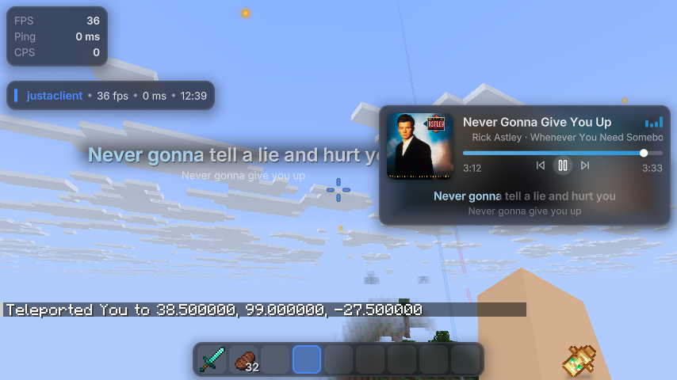

- **Spotify card**: album cover (rounded, with a blurred copy of the cover behind the card), title and artist, a
  progress bar, previous / play / next buttons, an equaliser while playing, and time-synced lyrics from
  [lrclib.net](https://lrclib.net) that fill in as they are sung. The card takes its colours from the cover. Open the
  chat to click the buttons, or bind media keys in its settings. Works with the Spotify app on Windows (system media
  controls, which also covers the Spotify web player in a browser), macOS and Linux (`playerctl`); turn off "Spotify
  only" to follow any player, such as a YouTube tab.
- **Lyrics in the sky**: the current line (or drifting music notes) drawn high in the sky where you were looking when
  the song started (Spotify > In the sky).
- **World**: time of day (presets or any time, plus moon phase), light colour (tint block light and sky light), water
  colour presets, clean world (hide falling blocks, fire on entities, rain and snow), end crystal size, spin, bob and a
  glow ring, and restyled F3 + B hitboxes (same information as vanilla).
- **Combat**: hit bubbles and a slash trail on swings. Four more hand styles: glass, smoke, snow and stripes.
- **Cosmetics**: hats (crown, top hat, cone, beanie) in your accent colour, and a client-side skin swap from a 64 x 64
  PNG in `config/justaclient/skins/`. Only you see them.

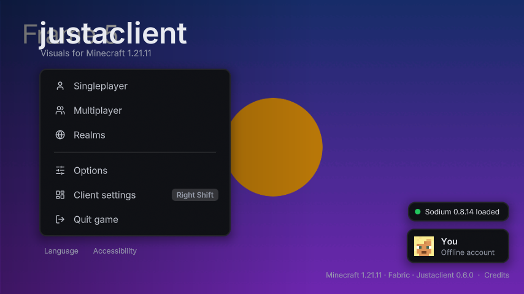

- **Your own title background**: put PNG, JPG or animated GIF files in `config/justaclient/backgrounds/` and pick
  "Your picture or GIF" under Utility > Title screen. Optional soft blur and darkening.
- **Stats page** (menu sidebar): lifetime play time with a two-week chart, kills, deaths, K/D, blocks mined, distance,
  diamonds, ancient debris and a few records, saved in `config/justaclient/stats.json`.

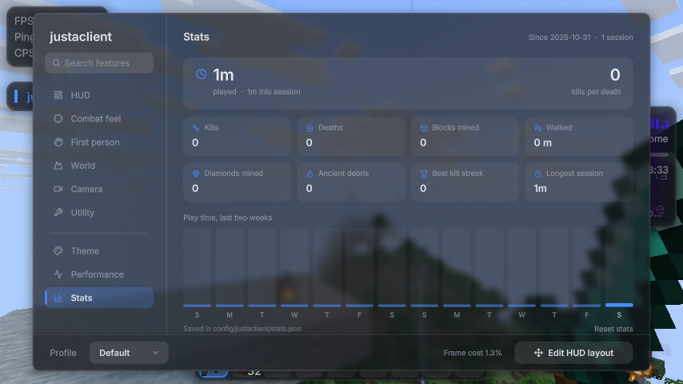

- **Block-found toasts**: a toast when you mine (or look at) diamonds, ancient debris, emeralds, spawners and more.
  Only blocks already on your screen; nothing is scanned through walls.
- **Physics trinket** (HUD): an item that falls, bounces, swings as you turn, and can be grabbed and thrown with the
  chat open.

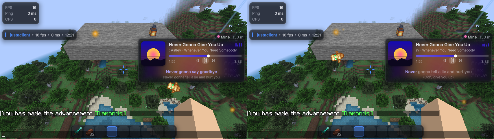

- **Performance mode** (Utility): no blur behind HUD widgets, lighter menu blur, a quarter of the effect particles,
  smaller background pictures, optional pause of screen shaders, and blur buffers freed when nothing uses them.
- **Tier badges** (Utility): PvP tiers from the public MC Tiers list (for example `HT3`) in name tags and the tab list,
  best tier or one game mode. The API address is a setting, since MC Tiers has moved API versions before.
- **Map polish**: the map glides when you zoom or jump to a waypoint, shows chunk lines up close, draws a dotted route
  to the selected waypoint with its distance, and has a find-me button (or Space). Arrow keys pan.

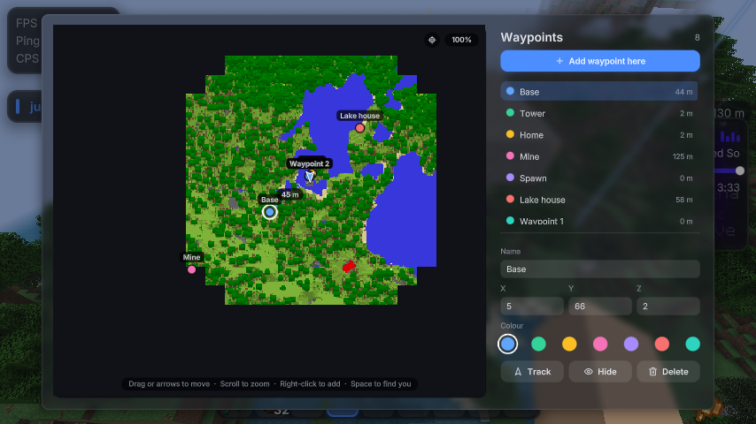

On 26.3 everything above works the same; light colour and time of day hook 26.3's new lightmap and world clocks.

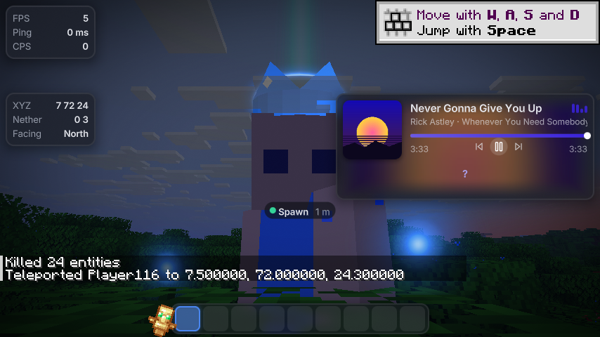

### M5: utility and cosmetics

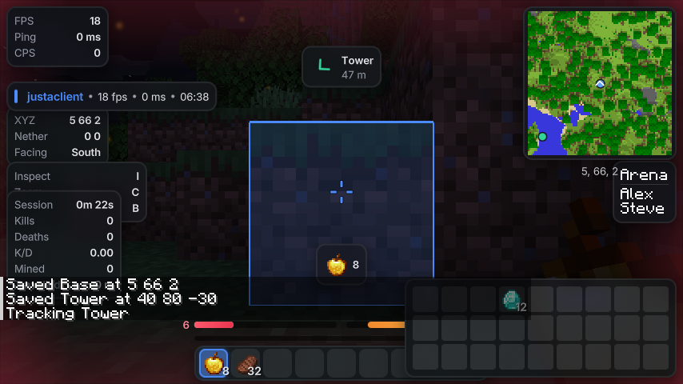

- **Waypoints**: light beams and labels with distance, an automatic death point, saved per world or server in
  `config/justaclient/waypoints.json`. Press B or use `/jwp add <name>`; `/jwp set <name> <x> <y> <z>` for coordinates.
- **GPS**: an arrow, name and distance for the waypoint you track (`/jwp gps <name>`, or "track nearest").
- **Minimap**: terrain only, coloured like vanilla maps, north-up or rotating, with waypoint dots. No players, mobs or
  caves; in the Nether it maps the floor you stand on.
- **Map (M)**: a full-screen version of the minimap over every loaded chunk, with this world's waypoints beside it.
  Right-click the map to add one; pick one to edit its name, coordinates and colour, track it, hide it or delete it.

- **Friends**: friends' name tags and tab list entries in your friend colour.
- **Stream mode**: one switch that hides your name, friends' names, coordinates and the server address on your screen.
- **Toggle sprint**, **auto reconnect** (a countdown button on the disconnect screen) and a **session stats** widget
  (play time, kills, deaths, K/D, blocks mined, distance).
- **Cosmetics**: a halo and orbs on springs around you in third person. Only you see them.

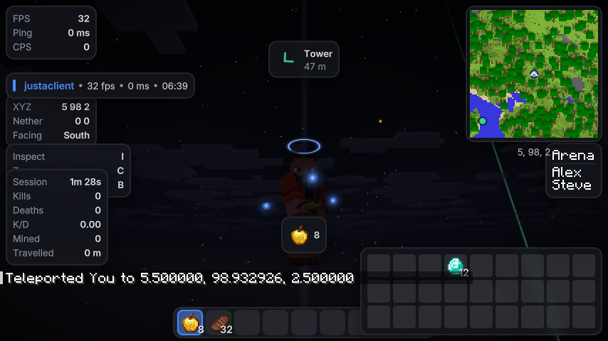
- **Discord status**: shows singleplayer, server and dimension on your profile. Create an application at
  discord.com/developers (its name is what Discord shows as the game) and paste its Application ID into the setting.

### M4: HUD and UI polish

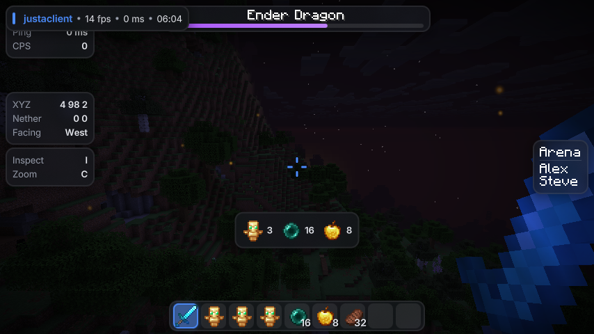

- **New widgets**: watermark, module list (sliding, gradient), keybinds, inventory and consumables (totems, pearls,
  gapples, food, arrows, wind charges).
- **Low health glow** at the screen edges, pulsing below a threshold you pick.
- **Boss bars and scoreboard** on glass panels with smooth bars.
- **Loading screen**: a glass card with a spinner and progress bar over the blurred panorama.
- **Ambient particles**: fireflies, drifting motes or linked dots around you.
- **Camera**: aspect ratio (4:3, 5:4, 16:10 or custom) and a separate hand FOV.
- **Weather toasts** and a **borderless window** option.

### M3: extras

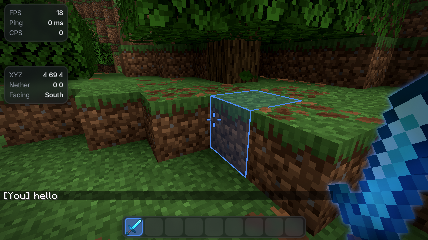

- **Color grading**: exposure, contrast, saturation, vibrance, temperature and tint with presets, plus a vignette.
- **Motion blur**, frame-rate independent.
- **Hand**: position, rotation, scale, swing style and speed, no equip dip, and an item **inspect** animation (I).
- **Hand glow**: a soft glow and gradient, chroma, outline or invert styles on your hand only. Off while a shader pack
  is on.
- **Enchant glint colour and speed**, separately for items and armour.
- **Overlays**: hide the pumpkin blur, powder snow and nausea wobble.
- **Name protect**: show another name in place of yours everywhere on your screen.

### M2: release

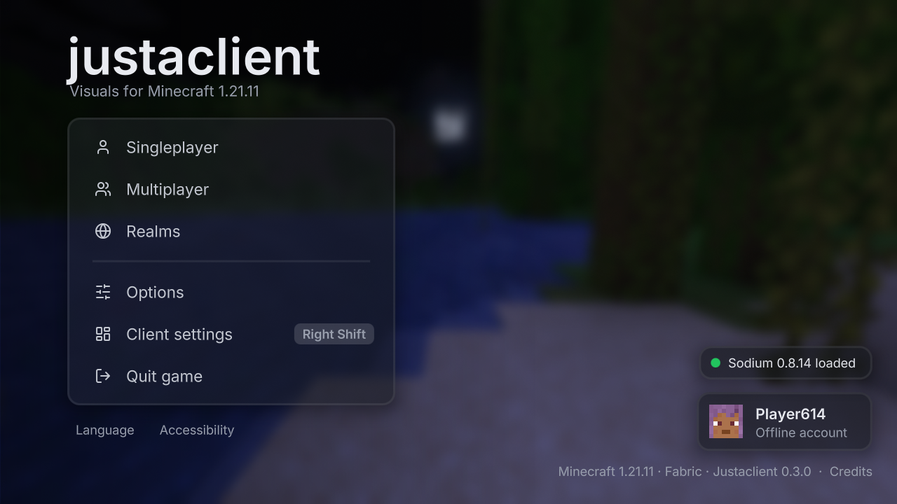

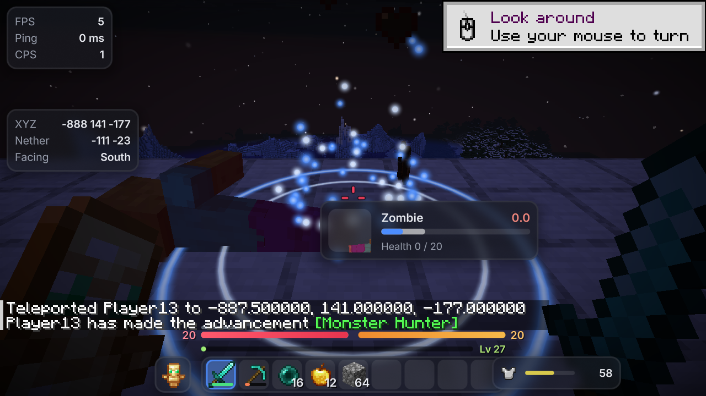

- **Title screen**: wordmark, a glass menu with keyboard navigation, your account and skin, and a blurred panorama,
  plain panorama or animated gradient behind it (Utility > Title screen). Turn it off for vanilla's.
- **Hotbar**: a glass hotbar with a sliding selection, offhand slot and attack indicator, plus smooth health (with a
  damage ghost, absorption and low-health pulse), hunger, armor, air and XP bars. Spectator mode keeps vanilla's.
- **Item overlay**: smooth or accent durability bars, cooldown rings, and sharp stack counts in every inventory.
- **Target HUD**: face, name and health of whatever you hit, with a damage ghost on the bar.
- **Combat feel** (all cosmetic, driven only by what vanilla already shows): hit particles, hit sounds, kill effects
  (ring burst, rising soul or shatter), totem pop effects with a pop counter, and a ring or orbit marker under your
  target.
- **Sky**: twinkling extra stars, an aurora over the north and shooting stars at night, plus an optional day sky tint.
  Overworld only, and drawn behind everything like vanilla's sky.
- **Fog**: push air fog further out and recolour it per dimension. Water, lava, blindness and darkness are untouched.
- **Trails and jump circles**: a ribbon or dotted trail behind you (and optionally other players), and rings when you
  jump or land.
- **Profiles**: copy a profile to the clipboard and paste one from a friend; it arrives as a new profile.
- **Performance page**: CPU time per feature (average, peak and share of the frame) against a 5% budget. GPU time is
  not included; compare FPS with a feature on and off for that.

The world effects (sky, fog, trails, jump circles, hit sounds) start off; turn them on under World and Combat feel.

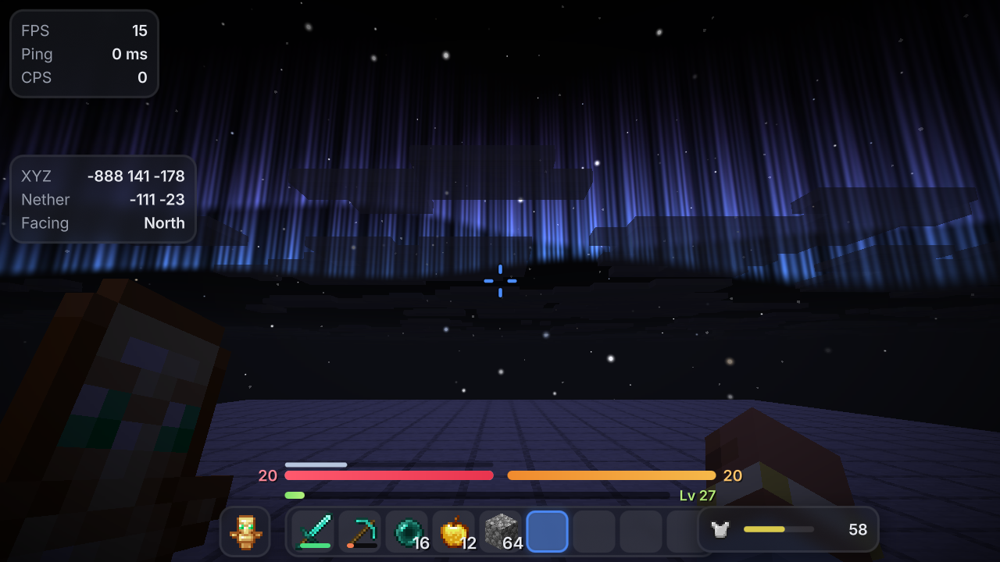

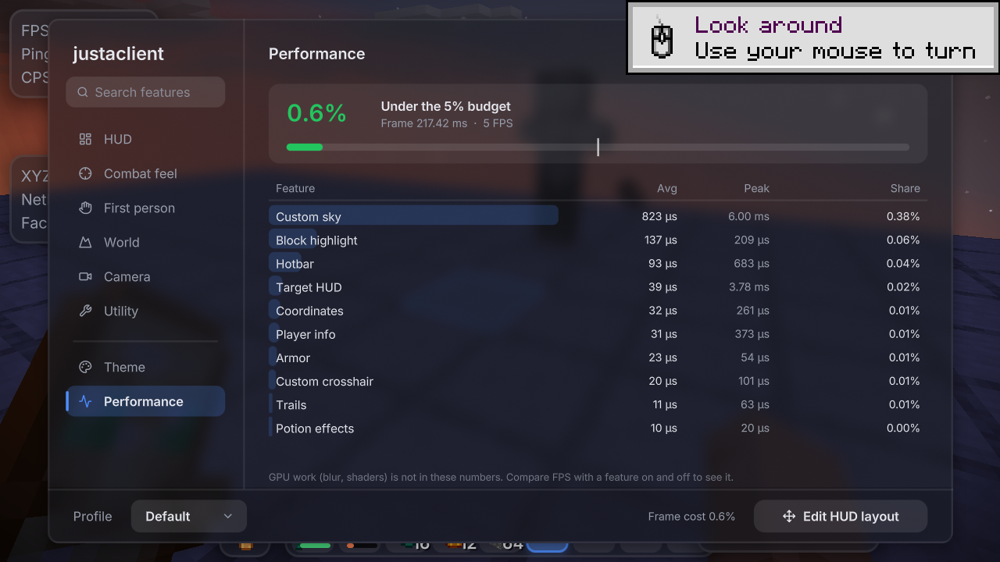

### M1: first playable

- **Click GUI** with categories, live search, animated switches, sliders, choices, colour pickers and key binders.
  Every feature has a toggle key.
- **Profiles**: each one is a JSON file in `config/justaclient/profiles/` (features, settings, keys and HUD layout), so
  they can be shared by copying the file. The theme is separate and stays in `config/justaclient.json`.
- **HUD editor** with snapping, guides, per-widget scale, and a tray to switch hidden widgets back on.
- **HUD widgets**: player info (FPS, ping, CPS, speed), coordinates (nether conversion, facing, biome, clock), armor
  durability (bar, percent or number), potion effects with timer rings, item cooldown dials, and toggle notifications.
- **Custom crosshair**: cross, dot, circle or plus; size, gap, thickness, colour, outline, hit pulse, target colour and
  dynamic spread. Follows vanilla's attack indicator setting.
- **Zoom**: smooth, scroll to adjust, slower mouse while zoomed, optional cinematic camera.
- **Block highlight**: an outline and fill that glide between blocks and show mining progress. Depth tested, never
  see-through.
- **Fire overlay**: lower it or hide it.
- **Copy coordinates** to the clipboard with one key.
- **Icons**: a Lucide icon set drawn with the same SDF text renderer, tinted by the accent.
- **Frame cost** in the menu footer: CPU time spent in Justaclient's HUD and world hooks as a share of the frame.

### M0: foundation

- **Render kit**: anti-aliased rounded rectangles, outlines, gradients, soft shadows, glow and ring arcs, drawn with
  signed distance field shaders and batched by Minecraft's GUI renderer.
- **Frosted glass**: a dual Kawase blur of the world (or title panorama) behind panels, done at half resolution and
  only on frames that show a glass panel.
- **Sharp text**: Inter rendered from multi-channel signed distance field atlases, so it stays crisp at every GUI scale.
- **Animation library**: easing curves, timed animations and springs, all scaled by the Motion setting.
- **Style tokens**: accent (solid, gradient or rainbow), surface colour and opacity, blur, corner radius, outline,
  font and motion. Default look is dark glass: blue accent `#4C8DFF`, 70% surface, 6 px corners.

## Project layout

| Path | What it holds |
| --- | --- |
| `common/src/main/java/` | Plain Java shared by both builds (frame stats, stopwatch, durations, world keys) |
| `src/main/java/dev/justaclient/world/` | Per-world store (`config/justaclient/worlds/<world>/`) |
| `src/main/java/dev/justaclient/render/` | Shape kit (`Draw`), blur (`BlurEngine`), pipelines, world effects (`WorldFx`) |
| `src/main/java/dev/justaclient/render/text/` | MSDF font loader and text renderer (`JacText`) |
| `src/main/java/dev/justaclient/anim/` | `Easing`, `Animation`, `Spring`, `Colors` |
| `src/main/java/dev/justaclient/config/` | Style tokens and JSON config |
| `src/main/java/dev/justaclient/feature/` | Feature and setting framework, the feature list, non-HUD features (`impl/`) |
| `src/main/java/dev/justaclient/hud/` | HUD renderer, widget base classes and the widgets (`widgets/`), session and lifetime stats |
| `src/main/java/dev/justaclient/media/` | Now playing: Spotify / media sources per OS, album art, synced lyrics |
| `src/main/java/dev/justaclient/profile/` | Profile files |
| `src/main/java/dev/justaclient/waypoint/` | Waypoint storage |
| `src/main/java/dev/justaclient/command/` | Client commands (`/jwp`, `/jfriend`) |
| `src/main/java/dev/justaclient/ui/` | Click GUI, HUD editor, theme and performance pages, title screen, controls |
| `src/main/java/dev/justaclient/mixin/` | Small hooks: zoom FOV and mouse, CPS, fire overlay, hit pulse, blur capture, combat events, item decorations, sky, fog, title screen |
| `src/main/resources/assets/justaclient/shaders/` | GLSL for shapes, glass, text, blur, world effects and the aurora |
| `tools/fonts/` | Script that regenerates the font and icon atlases (`icons.txt` lists the icons) |

## Development

- `gradlew runClient` launches the dev client; `gradlew build` makes the jar.
- `gradlew genSources` decompiles Minecraft (official Mojang names) for reading.
- 1.21.11: Java 21+, Fabric Loom 1.16, official Mojang mappings.

### The 26.3 build (`mc26.3/`)

Minecraft 26.x is unobfuscated and replaced the renderer (the new `renderpearl` GPU API, with Vulkan or OpenGL),
windowing and input (SDL instead of GLFW) and the GUI (`GuiGraphicsExtractor`). Rather than bend one source tree
around both, `mc26.3/` is its own Gradle build with a ported copy of the Java sources:

- `gradlew -p mc26.3 runClient` / `gradlew -p mc26.3 build`. Needs Java 25 (Loom 1.19, Fabric API 0.165, Sodium 0.9.2).
- Fonts, icons, textures and lang files come from the root `src/main/resources`. Files in `mc26.3/src/main/resources`
  win over the root ones: `fabric.mod.json`, the mixin config and the shaders (26.x needs `layout(location)` on every
  shader input and output, and `#include` instead of `#moj_import`).
- A change to a feature usually needs making in both trees. The render code differs most: `render/` (pipelines,
  post FX, hand glow, blur, world effects) and the mixins are rewritten for 26.3, most of the rest is the same with
  renamed Minecraft classes.
- Release jars are named `justaclient-<version>+<minecraft version>.jar`. CI builds both.

## Credits

- [Inter](https://rsms.me/inter/) by Rasmus Andersson, SIL Open Font License 1.1 (`assets/justaclient/msdf/Inter-LICENSE.txt`).
- [Lucide](https://lucide.dev/) icons, ISC License (`assets/justaclient/msdf/Lucide-LICENSE.txt`).
- Dual Kawase blur after Marius Bjørge, "Bandwidth-Efficient Rendering", SIGGRAPH 2015.

## License

MIT, see `LICENSE`.
