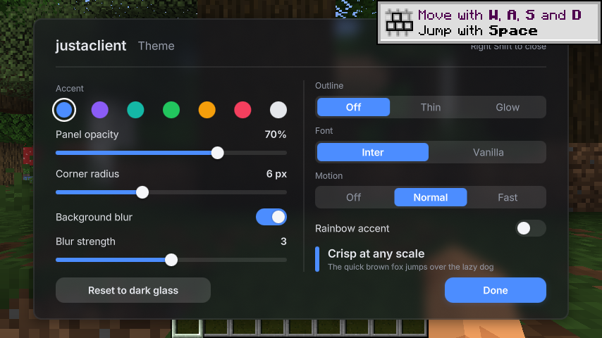

# Justaclient

A visuals-only Fabric client for Minecraft Java **1.21.11**. Smooth animated UI, frosted-glass panels, crisp fonts and a
look you can fully re-theme. No cheats: nothing that reveals hidden information or automates play.

Requires **Fabric API** and **Sodium**.

## Quick start (Windows)

1. Install **Java 21** (Temurin): https://adoptium.net/temurin/releases/?version=21
2. Double-click **`start.bat`** and pick:
   - **1 Play**: launches Minecraft with Justaclient, Fabric API and Sodium already loaded. The first launch downloads
     Minecraft and takes a few minutes; later launches are quick. It runs offline as a dev player, so use singleplayer.
   - **2 Build**: makes the mod jar in `build\libs\` for your normal launcher.
3. In game (or on the title screen), press **Right Shift** to open the Justaclient menu.

macOS / Linux: `./start.sh` to play, `./start.sh build` to build.

## Install into your own launcher

1. Build with `start.bat` option 2 (or `gradlew build`).
2. Copy `build/libs/justaclient-<version>.jar` (not the `-sources` jar) into your `.minecraft/mods` folder.
3. Also put in `mods`: [Fabric API](https://modrinth.com/mod/fabric-api) and [Sodium](https://modrinth.com/mod/sodium),
   both for 1.21.11, and run the Fabric 1.21.11 profile.

## What is in this build (M0: foundation)

- **Render kit**: anti-aliased rounded rectangles, outlines, gradients, soft shadows and glow, drawn with signed distance
  field shaders and batched by Minecraft's GUI renderer.
- **Frosted glass**: a dual Kawase blur of the world (or title panorama) behind panels, done at half resolution and
  only on frames that show a glass panel.
- **Sharp text**: Inter rendered from multi-channel signed distance field atlases, so it stays crisp at every GUI scale.
- **Animation library**: easing curves, timed animations and springs, all scaled by the Motion setting.
- **Style tokens**: accent (solid, gradient or rainbow), surface colour and opacity, blur, corner radius, outline,
  font and motion. Default look is dark glass: blue accent `#4C8DFF`, 70% surface, 6 px corners.
- **Theme menu** on Right Shift: change every token live. Settings save to `config/justaclient.json`.

## Project layout

| Path | What it holds |
| --- | --- |
| `src/main/java/dev/justaclient/render/` | Shape kit (`Draw`), blur (`BlurEngine`), pipelines |
| `src/main/java/dev/justaclient/render/text/` | MSDF font loader and text renderer (`JacText`) |
| `src/main/java/dev/justaclient/anim/` | `Easing`, `Animation`, `Spring`, `Colors` |
| `src/main/java/dev/justaclient/config/` | Style tokens and JSON config |
| `src/main/java/dev/justaclient/ui/` | Theme screen and widgets |
| `src/main/resources/assets/justaclient/shaders/` | GLSL for shapes, glass, text and blur |
| `tools/fonts/` | Script that regenerates the font atlases |

## Development

- `gradlew runClient` launches the dev client; `gradlew build` makes the jar.
- `gradlew genSources` decompiles Minecraft (official Mojang names) for reading.
- Java 21, Fabric Loom 1.16, official Mojang mappings.

## Credits

- [Inter](https://rsms.me/inter/) by Rasmus Andersson, SIL Open Font License 1.1 (`assets/justaclient/msdf/Inter-LICENSE.txt`).
- Dual Kawase blur after Marius Bjørge, "Bandwidth-Efficient Rendering", SIGGRAPH 2015.

## License

MIT, see `LICENSE`.
