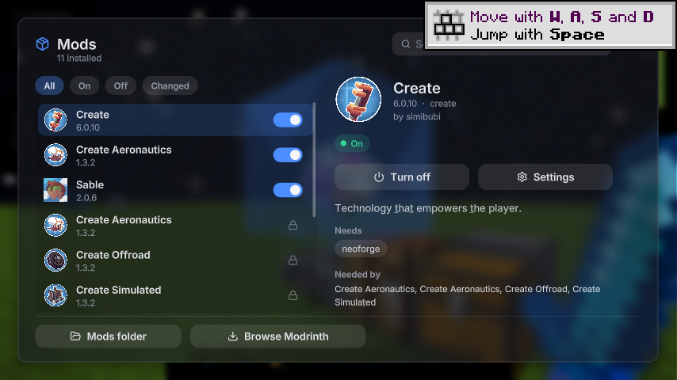
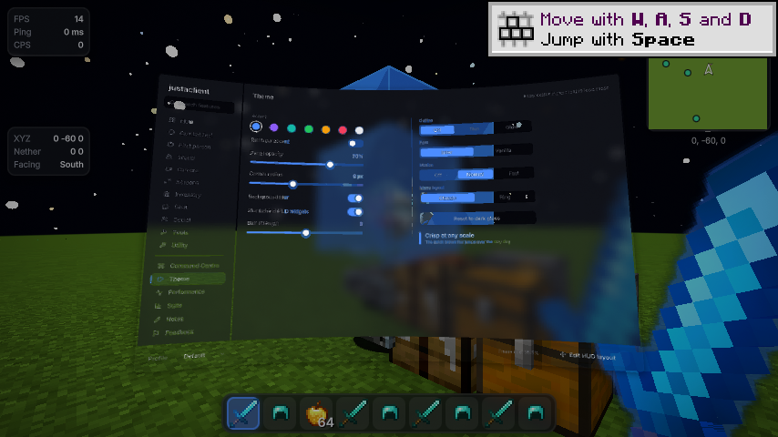

# NeoForge 1.21.1 port

Target verified on 2026-11-08 (Australia/Brisbane) against the official Modrinth release metadata:
[Create Aeronautics](https://modrinth.com/mod/create-aeronautics) 1.3.2+mc1.21.1
supports Minecraft 1.21.1 / NeoForge. This is a separate native build; the Fabric
1.21.11 and 26.3 source trees remain intact.

## Build and run

Use Java 21 or newer. This build has its own Gradle 9.2.1 wrapper, matching the
NeoForge 1.21.1 ModDevGradle template. From this directory:

```sh
./gradlew build
./gradlew runClient
```

From the repository root, use `./start.sh 1.21.1 build` or Windows `start.bat`
version 3. Output: `build/libs/justaclient-0.12.5+1.21.1-neoforge.jar` relative
to this directory. Install into a NeoForge 1.21.1 instance, not a Fabric instance.

## Implementation

- Native NeoForge entrypoint, lifecycle, GUI, input, chat, command, tooltip, HUD,
  world-rendering and configuration-screen integrations.
- Backported OpenGL shader programs for rounded shapes, MSDF text, glass, blur,
  colour grading, motion blur, hand effects and spatial menus. The curved-panel
  intersection avoids a ternary expression that Veil 4.3.2 rewrites incorrectly.
- Native 1.21.1 recipe, skin/cape, hitbox, sky, fog, lightmap and item hooks.
- Modrinth searches/installations select NeoForge. The Mods panel reads NeoForge
  and Forge TOML metadata, including bundled mods and required dependencies.
- Plain Java comes from `../common/`; four loader-specific classes have native
  copies. Feature/UI code has its own versioned tree, like the existing 26.3 port.
- Firefly and dry-grass ambience use original procedural equivalents, because
  those vanilla sound events do not exist in 1.21.1. The six bundled Vorbis
  files are MIT-licensed and regenerated with `python tools/generate_ambience.py`
  (requires ffmpeg). No later-version Minecraft audio is redistributed.

## Validation

- Gradle 9.2.1 build succeeds; all 256 JUnit tests pass.
- Live client loads Create 6.0.10, Sable 2.0.6 and Create Aeronautics 1.3.2,
  including their bundled Flywheel, Ponder, Veil and companion modules.
- A real singleplayer world loads and saves with rendering effects enabled: sky,
  lightmap, hitboxes, hand effects, ambient particles, minimap and post-processing.
- The complete in-world UI tour produces 49 screen captures, including every
  settings category, panels, helpers, vanilla menus and containers. Title screens
  were checked separately. Classic settings, Mods, ring and curved spatial menus
  also render at GUI scales 2 and 4. Real mouse clicks and slider drags were verified
  on a curved panel with Veil active. Both startup and in-world runtime self-tests pass.
- Validation uses Java 21 and Mesa software OpenGL on Linux. Multiplayer, shader
  packs, other mod combinations, and building/flying Aeronautics vehicles have
  not been exhaustively tested. Windows launch scripts were reviewed but cannot
  be executed in this Linux environment.





Developer checks (all opt-in; normal users do not run these):

```sh
./gradlew runClient -PjacSelfTest -PjacUiTour=/tmp/jac-tour -PjacUiScales=2,4
./gradlew runClient -PjacSmokeWorld -PjacSelfTest -PjacUiTour=/tmp/jac-world-tour
./gradlew runClient -PjacSmokeWorld -PjacSmokeSpatial -PjacUiTour=/tmp/jac-spatial-tour
```

`jacSmokeWorld` creates/opens only `Justaclient-Port-Smoke` under this build's
`run/saves/` and enables a set of visual effects in that test instance. UI tours
save screenshots and quit when finished. Additional filters: `-PjacUiOnly=mods,hud`
and `-PjacUiWait=3500` (milliseconds).
